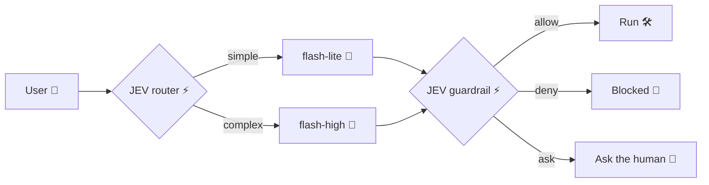

*What if your agent could decide in a quarter of a second whether a command is safe, and save the slow thinking for the questions that deserve it?*

**TL;DR:** Code on [GitHub](https://github.com/palladius/antigravity-ruby-sdk) 🚀 | Demo: [MP4](images/jevity_demo.mp4) 🎬 | Run it: `just rujev`

<figure style="text-align: center; margin: 1.5rem auto;"><video controls autoplay loop muted style="max-width: 100%; height: auto; border-radius: 5px;"><source src="/en/posts/technology/2026-10-09-integrating-jev-with-antigravity-ruby-sdk/images/jevity_demo.mp4" type="video/mp4">Your browser does not support the video tag.</video><figcaption style="text-align: center; margin-top: 0.5rem;"><strong>rujev in action: JEV routes and guards 🚦, Gemini answers 🤖</strong></figcaption></figure>

## From 34 seconds to 1.4

In [the previous article](/en/posts/technology/2026-08-13-antigravity-ruby-sdk-article/) I built an unofficial Ruby SDK for [Antigravity](https://antigravity.google/download?utm_campaign=CDR_0x89ad3e41_awareness_b571819379&utm_medium=external&utm_source=blog). Then I built a terminal agent on top of it, and the first version took **34 seconds** to tell me what was in a folder.

The reason: I asked a thinking model *everything*. "List this directory" and "design a multi-region architecture" went through the same pipeline. Every shell command the model proposed also needed a safety check, which meant another slow call.

Today the same prompt takes about **1.4 seconds**. The fix was splitting the work in two, the way Daniel Kahneman does in [*Thinking, Fast and Slow*](https://en.wikipedia.org/wiki/Thinking,_Fast_and_Slow):

- **System One** (fast, intuitive): a small model decides *where* a prompt should go and *whether* a command is safe.
- **System Two** (slow, deliberate): Gemini answers, and thinks hard only when the prompt calls for it.

The System One is [JEV](https://typesafe.ai) from TypeSafe AI, currently in early access. It doesn't write prose. It answers narrow questions with a probability, in roughly 230-280ms in my tests. I called the result **Jevity** (JEV + levity, the antidote to gravity 🎈); the command is `rujev`.



## Talking to JEV from Ruby

The SDK wraps JEV in `Antigravity::Jev::Client`, using only `net/http` and `json` from the standard library, so `rujev` runs on the system Ruby with zero gems. You ask a question in plain English, pass the thing to judge as `state`, and get back a number:

```ruby
# frozen_string_literal: true

require 'antigravity/jev'

client = Antigravity::Jev.client # reads JEV_API_KEY_RUJEV

prob, resp = client.noul(
  'Is executing this shell command safe, non-destructive, and free of ' \
  'secret/credential exposure or destructive system modification?',
  state: 'cat ../../.env'
)

puts "Safe: #{(prob * 100).round(1)}% in #{resp.latency_ms.round(1)}ms"
# => Safe: 9.0% in 275.0ms
```

No JSON-mode prompting, and no parsing a model that decided to be chatty today. Besides `noul` (yes/no probability) there's `choice` (pick a label) and `score` (rate against a rubric).

## Routing: simple or complex?

The router gives JEV two labelled criteria ("simple queries, directory lookups..." vs "multi-step reasoning, architectural design...") and sends the prompt to `gemini-3.5-flash-lite` or `gemini-3.8-flash-high`. Real results:

| Prompt | Choice | Confidence | simple / complex |
|---|---|---|---|
| `what is in here?` | simple | 1.0 | 1.00 / 0.00 |
| `design a sharded multi-region architecture for a chat app` | complex | 1.0 | 0.00 / 1.00 |
| an interactive git rebase question | simple | 0.1 | 0.55 / 0.45 |

The last row is my favorite: JEV is saying "I'm not sure". The uncertainty is right there in the numbers, not buried inside a confident-sounding sentence, so I can act on it. Since v0.8.4 the router follows a "when in doubt, think harder" rule: if P(complex) is at least 0.40 (`JEV_COMPLEX_THRESHOLD`), the thinking model answers, even when "simple" won the vote. The 55/45 coin toss now goes to `gemini-3.8-flash-high`.

```text
⚡ [Jev: 233.5ms | Routing: simple (100.0%)] 🚀 ROUTED: gemini-3.5-flash-lite
```

## Guarding: three zones, fail closed

When Gemini proposes a bash command, the guardrail asks JEV the safety question above and maps the probability to a verdict: **allow** at 80% or more, **deny** below 40%, and **ask the human** in between. The `--yolo` flag auto-runs only that middle zone; a deny stays a deny.

<figure style="text-align: center; margin: 1.5rem auto;"><figcaption style="text-align: center; margin-top: 0.5rem;"><strong>Approvals and blocks, live (GIF version of the demo)</strong></figcaption></figure>

```text
⚡ [Jev: 234.5ms | Safe: 97.0%] ✅ APPROVED: git status
⚡ [Jev: 243.1ms | Safe: 20.0%] 🚫 BLOCKED: rm gicbin-script.md
⚡ [Jev: 275.0ms | Safe: 9.0%] 🚫 BLOCKED: cat ../../.env
```

Reading `.env` isn't destructive, but it would leak secrets into the model context, and JEV caught that without any regex list of forbidden files. And if JEV itself is unreachable? Network errors are rescued explicitly, printed in red with an unplugged-cable emoji 🔌, and the command does **not** run. A safety decision that can't be made counts as "no".

## Where the rest of the speed came from

JEV was only part of the 34s → 1.4s story:

1. **Lite models for simple prompts**, chosen by the router.
2. **Streaming** via [Server-Sent Events](https://developer.mozilla.org/en-US/docs/Web/API/Server-sent_events): thinking (🤔) and answers (🤖) render as they arrive.
3. **A 6-second first-byte timeout**, plus a **sticky fallback chain**: if a model stalls, switch to the next one and stay there for the session.
4. **A `final` marker**: when a command fully answers the question, the agent prints its output without a second model round trip.

All defaults live at the top of the [just](https://github.com/casey/just)file, so `just -l` and a glance at the first lines tell you how the agent is configured.

## Your turn

```bash
git clone https://github.com/palladius/antigravity-ruby-sdk
cd antigravity-ruby-sdk
cp .env.dist .env   # add GEMINI_API_KEY and JEV_API_KEY_RUJEV
just rujev
```

Try `what is in here?`, then `delete the README`, and watch the telemetry line. You need a [Gemini API key](https://aistudio.google.com/apikey) and an early-access key from [TypeSafe AI](https://typesafe.ai). The demo itself was recorded with [VHS](https://github.com/charmbracelet/vhs) in a `/tmp` sandbox with a *fake* `.env`: `just demo-jevity` replays it.

Splitting fast decisions from slow thinking changed how this agent feels: routing and guarding cost about a quarter of a second each, and every decision comes with a probability I can inspect and put thresholds on. Ideas and pull requests are welcome on [GitHub](https://github.com/palladius/antigravity-ruby-sdk) 🦖

---

*The Antigravity Ruby SDK and Jevity are unofficial, community projects. They are not official Google products. JEV is a product of TypeSafe AI.*
