*By **Riccardo "Palladius" Carlesso** — proud dad to Ale & Seby and improvised 3D game designer. Built hands-off with [**Gemini 4**](https://deepmind.google/models/gemini/) inside [**Antigravity**](https://antigravity.google/) and the [**Niccolò Game Design** skill](https://github.com/palladius/gemini-cli-palladius-public-goodies/blob/main/skills/niccolo-game-design/SKILL.md). Zurich & Colmar, October 2026.*

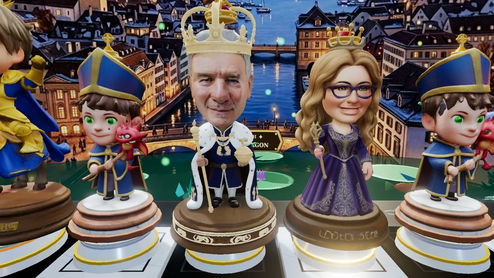

> 🧭 *Short version (≈ 8 min). The long, lab-notebook edition with every number and every engine is [here](/en/posts/technology/2026-10-15-carchess3d-family-chess/).*

---

## 🍕🌹 1. From a *Bufalina* in Naples to My 10th Anniversary in Colmar

A few weeks ago I was in **Naples** for [Fabio Biondi's Gemini Day](https://gdg.community.dev/events/details/google-gdg-napoli-presents-agentic-apps-con-google-gemini-sdk-e-typescript/) at Università Federico II. You know how it goes in Italy: two minutes of small talk, an espresso at the bar, and suddenly you are all having lunch together.

Over a *pizza bufalina*, **Niccolò and his friends** told me about their obsession: 3D games, clean game architecture, and tools like [Tripo](https://www.tripo3d.ai/) that turn a flat 2D picture into a textured 3D object. I had just built [Pupurabbu 3D](https://pupurabbu-3d-272932496670.europe-west6.run.app), a kid-friendly 3D explorer for my two boys, so I listened carefully.

Three weeks later I had packaged Niccolò's wisdom into an agent skill ([`niccolo-game-design`](https://github.com/palladius/gemini-cli-palladius-public-goodies/blob/main/skills/niccolo-game-design/SKILL.md)) and let [Gemini 4](https://deepmind.google/models/gemini/) build a 3D chess game with it. Hands-off. While I was in **Colmar**, Alsace, celebrating my **10th wedding anniversary with my wife Kate**. 🥂

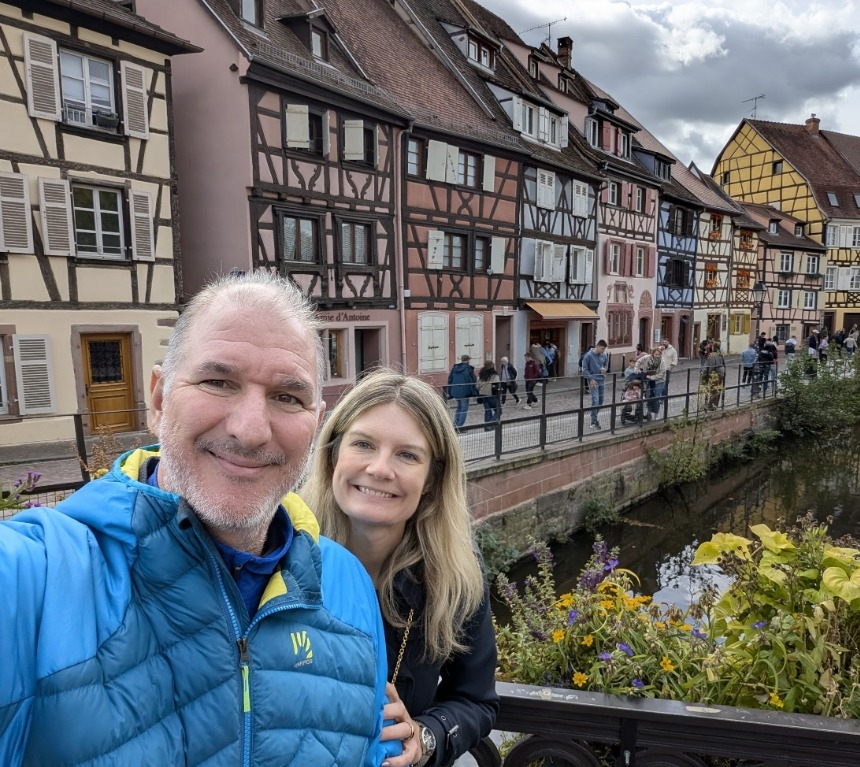

While Kate and I strolled past the half-timbered houses of *Petite Venise* (no laptop at dinner, no SSH from the phone), two Linux boxes 150 km south were working day and night: my home rig **`pupurabbux`** with an RTX 5080, and a second, beefier box without a GPU. Orchestrated by **Gemini 4 Argon** inside **Antigravity**, a swarm of subagents and critics sculpted 50 3D models of our family, compiled CUDA kernels for a GPU architecture too new for the prebuilt wheels, had every mesh and video frame judged by an *Adversarial Art Director*, and wrote 121,000 lines of code and tests. For the record: I write Bash and Ruby. I did not type a single line of JavaScript.

The result is **[CarChess3D](https://github.com/palladius/carchess3d)**: an offline-first, zero-build 3D chess game set in an enchanted swamp in front of Zurich's Grossmünster. 🏰🚽

---

## ⏱️ 2. The Numbers, As an SRE Would Report Them

I am an old-school Site Reliability Engineer. Marketing stories bore me; timestamps and commit hashes do not. From `git log` and the 76 Antigravity sessions across the two machines:

- **202 commits**, 159 of them between Friday evening and Sunday night.
- **54 sessions, 16,118 agent steps, 263 human prompts** on the orchestrator box: about **55 autonomous steps per prompt**.
- **760 million context tokens**, 94 % of them served from cache.
- **50 verified `.glb` models**, 63 unit tests, 121,331 lines of code, zero IP-safety violations.

### ⚡ 38 Minutes from `/goal` to a Playable Game (Saturday, October 10)

At **10:31** on Saturday morning, right before heading out into Colmar's cobbled streets, I fired a single `/goal` command in a git worktree. The prompt is **[here, steal it](https://github.com/palladius/carchess3d/blob/main/etc/prompts/GOAL_BUILD_CARCHESS3D.md)**. I had Gemini 4 *High* write it for me, following two tricks from [Geneviève Huskens](https://www.linkedin.com/in/ghuskens/):

[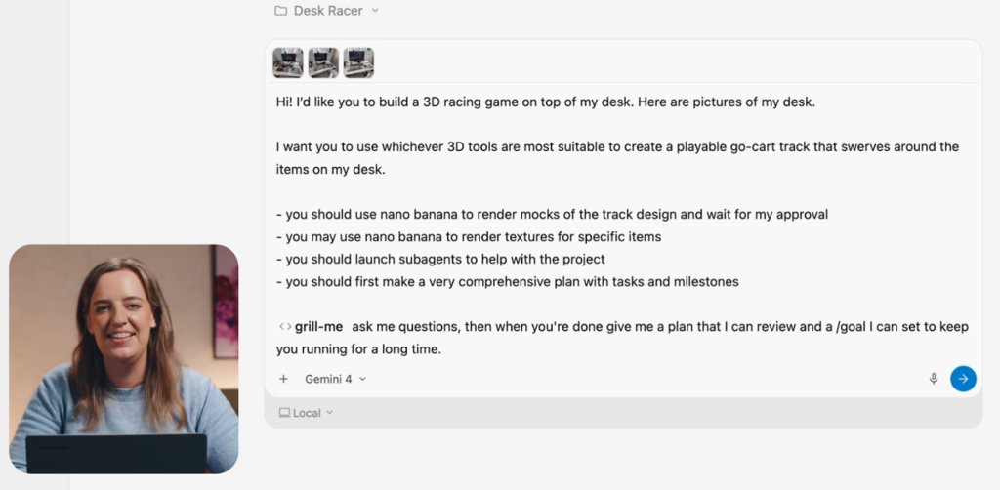](https://lnkd.in/p/e_Vk3W64)

▶️ **[Watch Geneviève's 2-minute "Desk Racer" demo on LinkedIn](https://lnkd.in/p/e_Vk3W64)** — she builds a 3D go-kart game on top of her own desk with exactly this prompt.

> 💡 **Geneviève's two tips**:
> 1. **Start with `/grill-me`**: *"ask me questions, then give me a plan I can review."* Let the agent interview you until the plan is solid.
> 2. **Ask for the `/goal` as a deliverable**: *"…and a `/goal` I can set to keep you running for a long time."* The agent writes its own long-running meta-prompt. You fire it and walk away. That is why I could spend the weekend in Colmar.

> ✍️ When Geneviève reviewed this article she added one sharp note: my prompt *micromanaged the subagents*. True. The human should state outcomes, guardrails and exit gates, and let the planner plan. So here is a **[clean, reusable `/goal` template](https://github.com/palladius/carchess3d/blob/main/etc/prompts/GOAL_TEMPLATE_DIDACTIC.md)**. Steal *that* one.

What the transcript recorded:

* `10:31` **Phase 1, blueprint** (9 min): a metric floor plan of the board and a grounding helper, so every future 3D piece stands exactly on its square.
* `10:41` **Phase 2, headless core, test-first** (7 min): event bus, seeded RNG, chess rules, the kids' luck meter, each with unit tests.
* `10:50` **Phases 3 & 4, four subagents in parallel** (20 min): +10,081 lines across 60 files. Scene, pieces, effects, HUD, offline service worker.
* `11:09` ✅ **A playable, unit-tested 3D chess game in the browser. 38 minutes after `/goal`.**
* `11:13` **Phase 5, adversarial critic loop** (66 min): round one scores 6.2/10 and lists five defects (everything looked like chrome because of a glTF `metallicFactor` trap). The loop iterates to **9.9/10** at `12:18`.

> 💡 **Verdict**: 38 minutes to a working game, 1 h 47 min to one the critic accepted. Zero human input in between.

Git never forgets, so here is the 38-minute game (commit `d257880`, checked out and booted again) next to the current build:

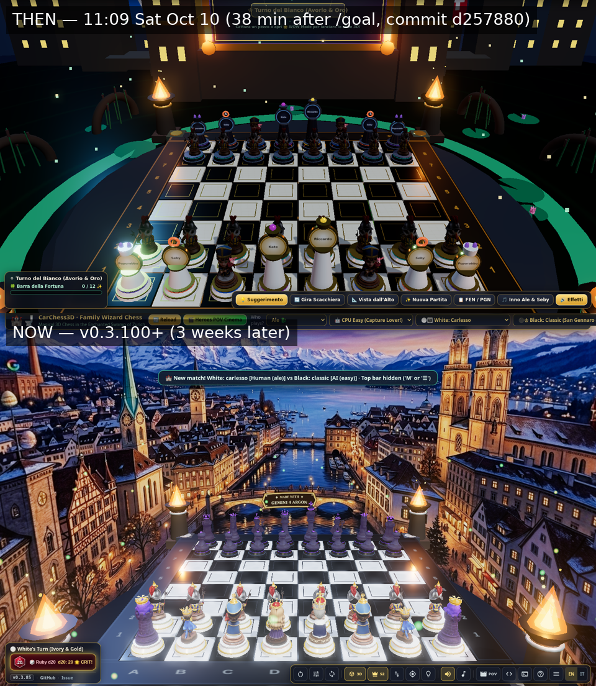

---

## 👑👦👶 3. Who Is on the Board?

Every piece is an affectionate, slightly ridiculous caricature of our family.

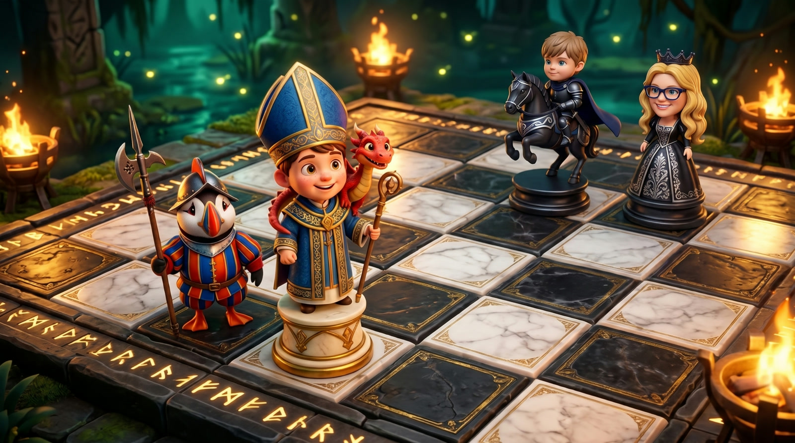

| Piece | Who | Why |
| :--- | :--- | :--- |
| **King 👑** | **Riccardo** (Dad) | A fantasy mage with six spells for six fights. And a golden throne 🚽. |
| **Queen 👸** | **Kate** (my wife) | She works in chocolate, so every attack is chocolate-based. 🍫 |
| **Bishop 🐉** | **Ale** (Alessandro) | Loves wizard stories and dragons: a young wizard with a tiny dragon familiar. |
| **Knight 🏎️** | **Seby** (Sebastian) | He rides horses. Obvious. |
| **Rook 🏰** | **Pupurabbu** | Seby's imaginary purple fluffy friend, peeking out of a stone tower. 💜 |
| **Pawn 🐧** | **Puffin** (×16) | My wife calls me *Puffin*. Swiss Guard uniform included. |

### 🎠 Meet the Kids in 3D

<table style="width:100%;text-align:center;border-collapse:collapse;">
  <tr>
    <td style="width:50%;padding:6px;"><video src="assets/gallery/turntable_knight_seby.mp4" poster="assets/gallery/turntable_knight_seby.gif" autoplay loop muted playsinline style="max-width:100%;border-radius:10px;"></video></td>
    <td style="width:50%;padding:6px;"><video src="assets/gallery/turntable_bishop_ale.mp4" poster="assets/gallery/turntable_bishop_ale.gif" autoplay loop muted playsinline style="max-width:100%;border-radius:10px;"></video></td>
  </tr>
  <tr>
    <td style="padding:4px 6px 14px;"><strong>Seby — Knight 🏎️</strong> <em>golden armor on his warhorse, 1.92 m</em></td>
    <td style="padding:4px 6px 14px;"><strong>Ale — Bishop 🐉</strong> <em>wizard's mitre with his little dragon, 1.55 m</em></td>
  </tr>
</table>

All six figurines, each scored 9.7/10 by the critic, at their true relative heights:

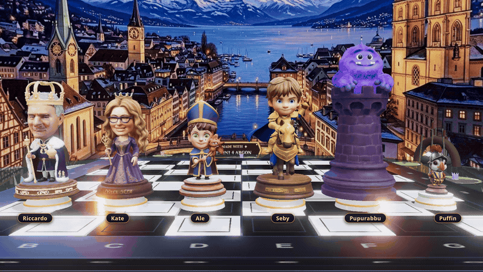

### 💜 The Brotherly Easter Egg

One rule in the combat engine is sacred: **Seby and his plushie Pupurabbu can never hurt each other**. When one captures the other there is no knock-out. They rush into a **super fluffy hug** while pink hearts rain over the board.

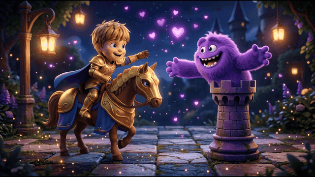

Captured pieces do not vanish into a sidebar graveyard either. They fly in an arc, splash into the swamp and bob on lily pads among the fireflies, with the Grossmünster and the lake behind them.

### 👨‍👦‍👦 The Real UAT

No test suite beats the sign-off from the actual customers:

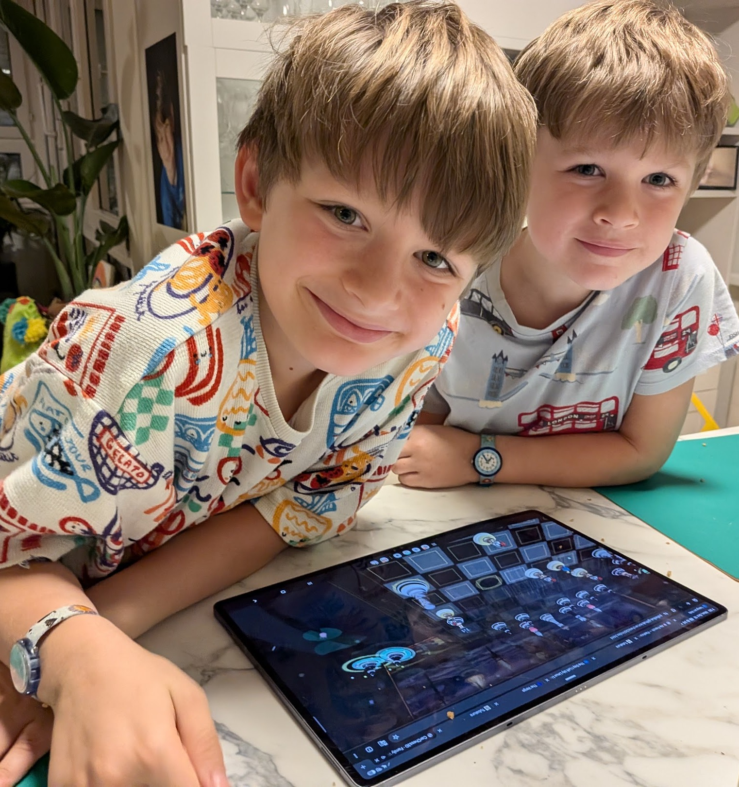

And the reason the project exists, in one frame and one 12-second orbit:

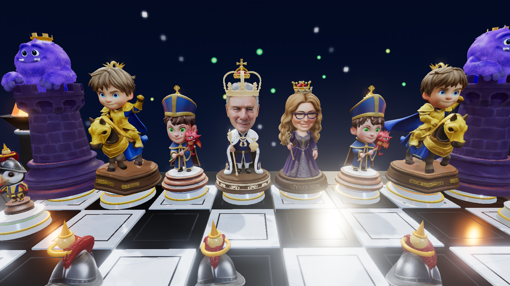

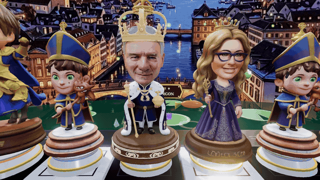

---

## 🔬 4. From a Smartphone Photo to a Game-Ready 3D Piece

Turning a casual photo into a textured, metrically grounded `.glb` that runs at 60 FPS on a tablet takes four steps: generate, reconstruct, slim down, judge.

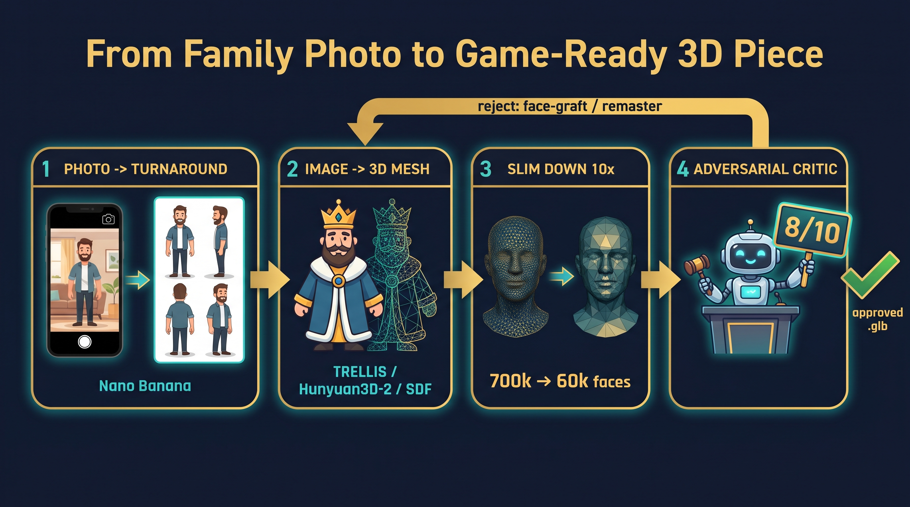

**Generate.** 3D diffusion models hate wide-angle perspective, so Nano Banana first turns the photo into a strict four-view turnaround (front, side, back, 3/4). The ground truth every engine had to chase:

| Dad (King Riccardo 🚽👑) | Mum (Queen Kate 👸💜) |
| :---: | :---: |
| 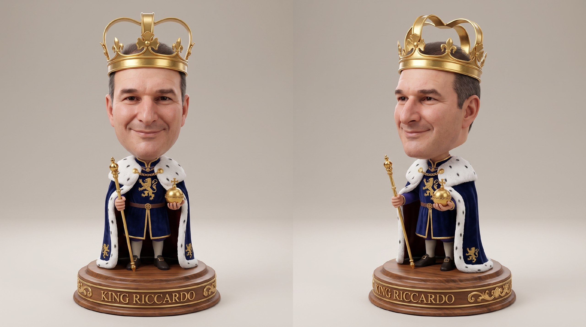 | 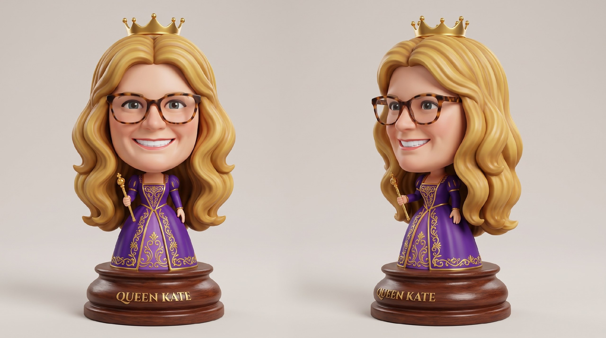 |

**Reconstruct.** Three engines, picked per piece: TRELLIS in the cloud, Hunyuan3D-2 on the local GPU, and a signed-distance-field sculptor for the classic pieces. When Hugging Face's free GPU quota ran out, the agent did not wait for a credit card: it moved the whole pipeline to the RTX 5080 at home and recompiled the CUDA kernels for a GPU architecture the prebuilt wheels did not know yet. Meshes came out in 32 seconds each.

**Slim down.** A raw mesh is about 700,000 triangles. Times 32 pieces, a tablet gives up. [Mesh decimation](https://en.wikipedia.org/wiki/Level_of_detail_(computer_graphics)) brought each piece down to 60,000 faces in under ten seconds, with noses and crowns intact.

**Judge.** My first King looked like a generic, clean-shaven doll. I complained. The agent built a *likeness critic* with my reference photos (eight facial traits, from the white tuft in the left eyebrow to the two-day stubble) and projected my real face onto the mesh until the critic was satisfied.

Two of my favourite before/after cards, concept → procedural placeholder → reconstructed 3D (created after Abbazia di Pomposa and San Gennaro, Saint Patron of Naples):

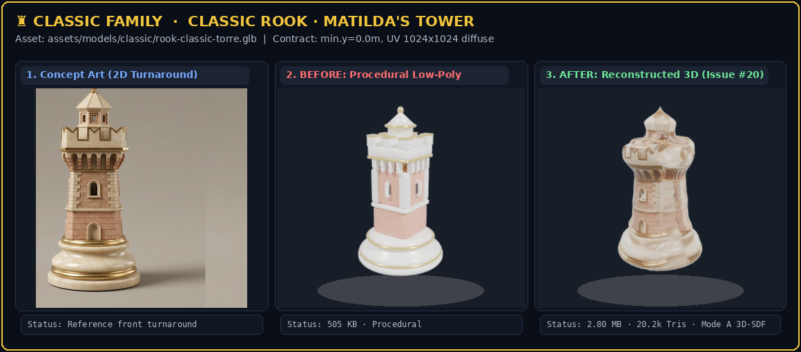

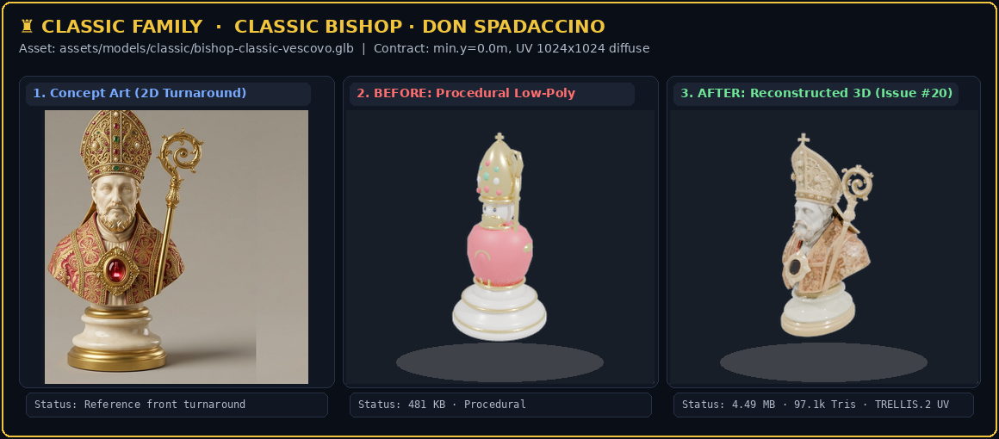

---

## 🤖💩 5. Separation of Powers: Builders vs. Critics

Left alone, generative pipelines happily ship deformed meshes and broken shaders. So the swarm had two castes: **builder agents** that write code, sculpt models and render videos, and **read-only critic agents** that score the result and cannot touch it.

After every 3D build a headless script shoots four diagnostic views and the critic grades them: `TOP_QUALITY` (≥ 8/10), `ACCEPTABLE`, or `FA_CAGARE` (Italian for *it sucks*). Anything below 6 fails the build. That is how Bishop Ale v2, rejected at 4/10 because "two half-dragons were fused into his chest", became a clean modular rig.

The same idea scaled up during the week:

- A **5-worker swarm** built all 36 attacker × defender battle animations, each worker owning a disjoint set of files so merge conflicts were impossible, with a sixth read-only worker auditing the other five.
- **36 Veo battle videos** play on a floating 16:9 screen when a piece is captured. Kate watched the first batch and spotted hallucinations immediately (towers vanishing, a second Puffin appearing). So a video critic agent pulled six frames from each clip, checked them for four forbidden defects, and regenerated the losers until all 36 scored ≥ 8/10.
- Playing on the tablet with the kids, White and Black were hard to tell apart from above. Rather than guess, the agents built a **blind readability benchmark**: a Gemini model is shown renders and asked to name each piece's role and colour, no hints. Five clarity modes later, recognition went from 5.0 to 9.5 out of 10.

### 🧪 The Agent That Plays Chess Every Morning

My favourite workflow: a scheduled Antigravity task launches headless Chromium every day, checks nine functional and visual gates, plays a match against the CPU, clicks the *Swamp* button ten times in a row to see if anything breaks, records a one-minute film, and opens a GitHub issue with the verdict. You can browse them live: [`label:"gemini-uat"`](https://github.com/palladius/carchess3d/issues?q=state%3Aopen%20label%3A%22gemini-uat%22).

---

## 💛 6. Niccolò's Game Architecture

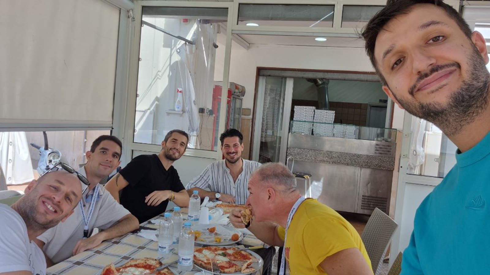

*The pizzeria table where it all started. Niccolò is holding the phone; I am holding the pizza.*

Without rules, an agent writes a 5,000-line `game.js` tangled in `if/else`. The [Niccolò Game Design skill](https://github.com/palladius/gemini-cli-palladius-public-goodies/blob/main/skills/niccolo-game-design/SKILL.md) gives it four, all borrowed from Robert Nystrom's [*Game Programming Patterns*](https://gameprogrammingpatterns.com/):

1. **One manager, one responsibility**, 300 lines max. Chess rules live in one place, the kids' luck meter in another, the battle choreography in a declarative matrix.
2. **A headless core.** Game logic never imports the DOM or the 3D engine, so it runs and is tested in plain Node.js in under two seconds.
3. **A queued, deterministic event bus.** Events describe past facts and are flushed once per tick. No re-entrancy bugs.
4. **Listeners, never callers.** Views, audio and storage subscribe to events; the logic never calls `sound.play()`.

---

## 🎮 7. Try It

No installs, no bundlers. Play on GitHub Pages:
- 🏰 **CarChess3D**: [palladius.github.io/carchess3d](https://palladius.github.io/carchess3d/)
- 🎬 **Heroes POV Cinema & Family Soundboard**: [showcase/?view=pov](https://palladius.github.io/carchess3d/showcase/?view=pov)
- 📸 **Visual progress, round by round, with timestamps**: [progress.html](https://palladius.github.io/carchess3d/progress.html)

---

## 🥂 8. What I Take Home

Two years ago, a custom 3D game starring your own family, with textured meshes, rigging, an AI opponent, 36 battle cutscenes and bilingual voice acting, would have cost an indie studio months. This one came together over an anniversary weekend, while the human was clinking Riesling glasses in Colmar.

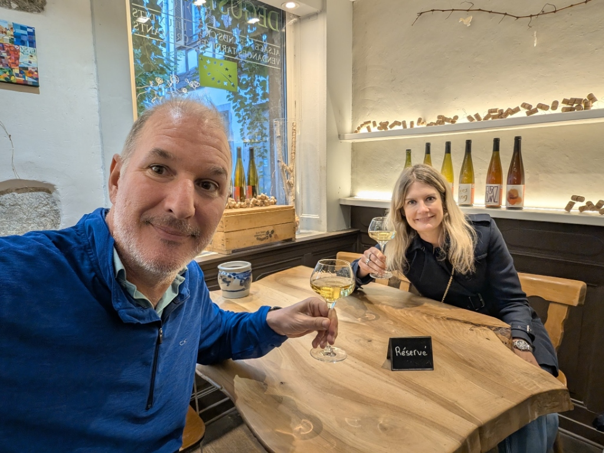

Good technology works in the background and gives you your weekend back.

*Have a great match, from the Carlesso Family!* 🦖👑👸🐉🏎️💜🐧
